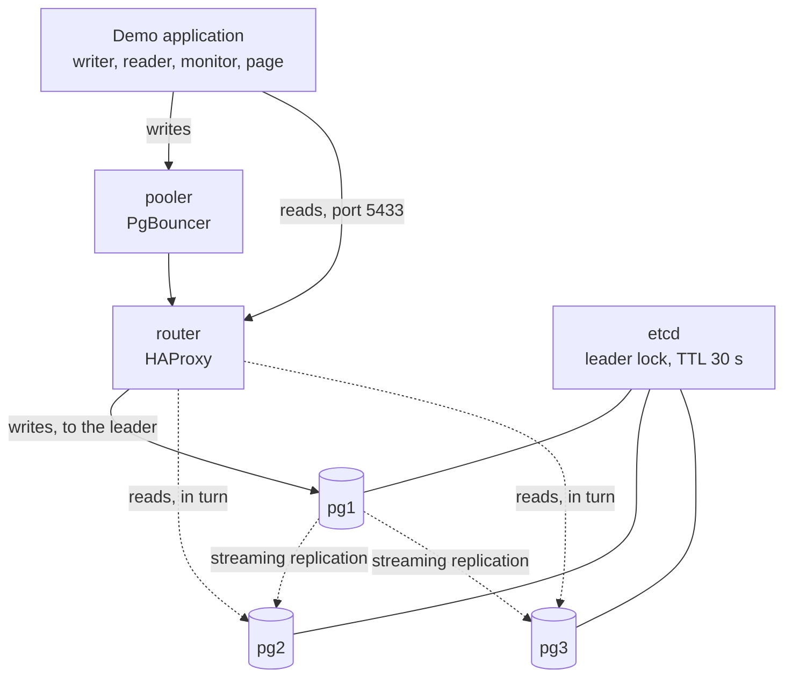

# PostgreSQL high availability, live

An [ISOGrid](https://isogrid.skyvault.pro) example: a three-node PostgreSQL cluster you can break from your browser, and watch heal itself.

The page shows three databases, one primary and two standbys. An application writes and reads continuously. You cut the power to a node, shut it down, or unplug it from the network. The nodes sit in three named sites, with an adjustable network delay between them. Then you watch:

1. Writes pause while the cluster decides who leads.
2. A standby is promoted, and writes move to it.
3. Reads keep flowing to the standbys the whole time.
4. The broken node comes back, rewinds, and rejoins as a standby.

After every incident, each write the database confirmed is read back from the new primary and counted. The page shows how many were lost.

Nothing on screen is simulated. Roles come from each node's Patroni API. The leader lock and its countdown come from etcd. The node that served each write and each read is asked of that node, on that very query.

## Architecture



| Service | What it does | Image |
| --- | --- | --- |
| `pg1`, `pg2`, `pg3` | PostgreSQL 16 under Patroni, which elects the leader | `patroni/Dockerfile` |
| `etcd` | Holds the leader lock | `quay.io/coreos/etcd:v3.5.16` |
| `router` | HAProxy. Port 5432 follows the leader, port 5433 balances the standbys | `haproxy:alpine` |
| `pooler` | PgBouncer in front of the router, transaction pooling | `edoburu/pgbouncer:v1.23.1-p2` |
| `dc1`, `dc2`, `dc3` | The links between sites, which add the simulated delay | `ghcr.io/shopify/toxiproxy:2.9.0` |
| `demo` | The application: API and page in one image | `Dockerfile` |

The cluster uses the same building blocks and settings as a managed high-availability PostgreSQL instance on ISOGrid.

## Run it

You need Docker with Compose.

```sh
git clone https://github.com/ISOGrid-by-SkyVault/postgres-ha-live.git
cd postgres-ha-live
docker compose up -d --build
```

Open http://localhost:8095. The first start takes a minute: the three nodes initialise and elect a primary.

For development, `docker compose --profile dev up -d` adds the API with reload and the page with hot reload on http://localhost:5195.

To start again from an empty cluster, run `docker compose down -v`.

## The three failures

| Button | What it does | What you see |
| --- | --- | --- |
| ⚡ Power cut | SIGKILL on the container | The dead primary still holds the leader lock. A countdown runs until the lock expires, up to 30 s. Then a standby is promoted. |
| ⏻ Shut down | Clean stop, SIGTERM | Patroni stops PostgreSQL and hands the lock back. A standby takes over within seconds. |
| ✂ Cut network | The node is unplugged but keeps running | It can no longer renew its lock, so it steps down to read-only on its own. The page shows its view "from inside". |

**⟳ Bring it back** restarts the node or plugs it back in. A node left down returns on its own after 180 s.

The wait after a power cut is deliberate. A standby may only take over once the old primary's lock has expired, so two primaries can never accept writes at the same time.

## Reads and load balancing

The application reads through the router's read port. HAProxy hands each connection to a standby in turn, so reads are shared between the standbys and none reach the primary. The page shows this three ways: hollow dots travelling to the standbys, a share bar per node, and a reads timeline coloured by the node that answered.

During a failover the reads do not stop. When a standby is promoted, the other one serves every read until the broken node rejoins.

## Sites and the simulated network

Each node is shown in its own site: `pg1` in Chéraga, `pg2` in Bab Ezzouar and `pg3` in Rouiba, three districts of Algiers between 9 and 29 km apart. The page shows the distance and the delay on each replication link.

The delay is real. Every node advertises itself to the others through its own link (`dc1`, `dc2`, `dc3`), a TCP proxy that holds each packet for the chosen time in both directions. Replication and Patroni's node-to-node calls wait for it. The router still reaches the nodes directly.

| Preset | Round trip added | What it stands for |
| --- | --- | --- |
| No delay | 0 ms | All nodes in one room |
| Metro fibre | 2 ms | Sites across one city. The default. |
| Congested | 40 ms | A saturated or long-distance link |
| Degraded | 200 ms | A failing link. Standbys visibly fall behind. |

Fibre adds about 1 ms of round trip per 100 km, so across one city the delay comes from equipment, not distance. Two milliseconds is a generous figure for these sites.

**The sites are an illustration.** They show how a metropolitan deployment behaves. They are not a statement of where any ISOGrid system is hosted.

The link is a proxy and not kernel traffic shaping, because Docker Desktop's WSL2 kernel is built without `tc netem`.

## Keys and URL parameters

| Key | Action |
| --- | --- |
| `P` | Power cut on the current primary |
| `S` | Clean shutdown of the current primary |
| `N` | Network cut on the current primary |
| `R` | Bring every node back |
| `V` | Check every write now |

- `?lang=en`, `?lang=fr` or `?lang=ar` picks the language. Arabic is right-to-left.
- `?clean` hides every button, for recording. The keys still work.
- `?key=…` is required to break nodes when `CONTROL_TOKEN` is set. Without it, visitors watch read-only.

## Settings

| Variable | Default | Meaning |
| --- | --- | --- |
| `DEMO_PORT` | 8095 | Port of the demo |
| `WRITES_PER_SECOND` | 5 | Write rate |
| `READS_PER_SECOND` | 8 | Read rate. 0 turns reads off. |
| `LINK_RTT_MS` | 2 | Round trip added between two nodes at start |
| `NODE_LABELS` | Chéraga,Bab Ezzouar,Rouiba | The site shown for each node |
| `LINK_DISTANCES_KM` | pg1-pg2=20,pg2-pg3=9,pg1-pg3=29 | Distances shown on the links |
| `AUTO_RECOVER_SECONDS` | 180 | Bring a node back on its own after this long. 0 turns it off. |
| `CONTROL_TOKEN` | empty | Require `?key=` to break nodes |
| `PATRONI_IMAGE` | built from `patroni/` | Use a Patroni image you already have |

## What the numbers mean

- **Confirmed writes** are writes the database answered "saved" to.
- **Interrupted writes** were refused or timed out during the switch. The application retries them. They are not lost writes, and some may in fact have committed.
- **Confirmed writes lost** is the count of confirmed writes missing from the new primary. Replication here is asynchronous, so a power cut can in principle lose the last writes that had not reached a standby. Patroni refuses to promote a standby that is more than 1 MB behind. The page shows the true number, whatever it is.

## How the demo breaks things

The demo container mounts the Docker socket and uses the Docker Engine API to kill, stop, disconnect and restart the node containers. That is acceptable on a laptop. Do not expose the demo on a public address without setting `CONTROL_TOKEN`, and never mount the socket of a machine you care about.

## Repository layout

- `backend/`: the FastAPI application. `engine.py` holds the writer, the reader and the monitor, and `chaos.py` breaks and repairs nodes.
- `frontend/`: the React page, built with Vite.
- `cluster/`: the HAProxy and PgBouncer configuration.
- `patroni/`: the node image.

## Docker Desktop note

Asked for the name of a stopped container, Docker Desktop's DNS can hang for minutes. That would stall Patroni exactly when a node is down. The compose file therefore gives the nodes and etcd fixed addresses in `/etc/hosts`.

## License

MIT. See [LICENSE](LICENSE).
